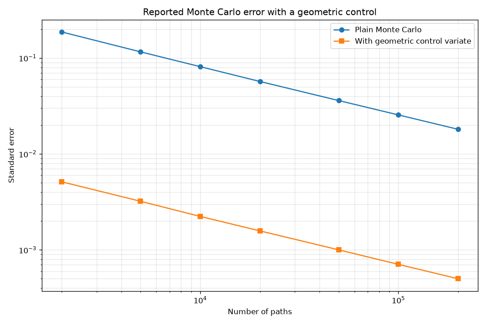

# Asian-option Monte Carlo pricer

Price a fixed-strike arithmetic-average Asian call under geometric Brownian motion using a geometric-average control variate.

**Seeded demo: price 5.857204 with the control variate versus 5.848114 for plain Monte Carlo.** The implementation reports a variance-reduction factor of 1,305.9 for this configuration.



## Quick start

From the repository root; no market-data download is needed:

```bash
python3 -m venv .venv
.venv/bin/pip install -r requirements-dev.txt
.venv/bin/python -m src.asian
```

Run `python -m src.make_figure` in the environment to regenerate the chart, or `python -m pytest -q` to run the tests. All inputs are explicit simulation parameters; no private data or credentials are used.

## Method

- Simulate discretely sampled geometric Brownian motion with antithetic paths.
- Calculate arithmetic and geometric average call payoffs.
- Use the geometric Asian closed-form price as the control expectation.
- Estimate the control coefficient from simulated payoff covariance.
- Compare the model-reported standard errors across path counts.

## Results

[Saved pricing output](results/pricing.json) records spot and strike 100, maturity one year, rate 5%, volatility 20%, 50 observations, 100,000 paths and seed zero.

| Estimator | Price | Reported standard error |
|---|---:|---:|
| Plain Monte Carlo | 5.848114 | 0.025505 |
| Geometric control | 5.857204 | 0.000706 |

The chart is generated from actual seeded simulations. These are model prices, not quotes or a fitted market study.

## What didn't work

Plain Monte Carlo is noisy at the same path count. Reported errors use the implementation's pathwise formula; antithetic-pair dependence is not separately accounted for. The model excludes stochastic volatility, jumps, calibration, puts and floating strikes. Independent-run confidence-interval validation remains a TODO.

## Tests, structure and licence

[](https://github.com/VChahar1/asian-option-mc/actions/workflows/tests.yml)

Four tests pass, checking the geometric benchmark, arithmetic/geometric ordering and variance reduction. `src/asian.py` contains pricing, `src/make_figure.py` generates the chart, `tests/` checks properties, and `results/` stores the demo evidence. Code: [MIT](LICENSE).
